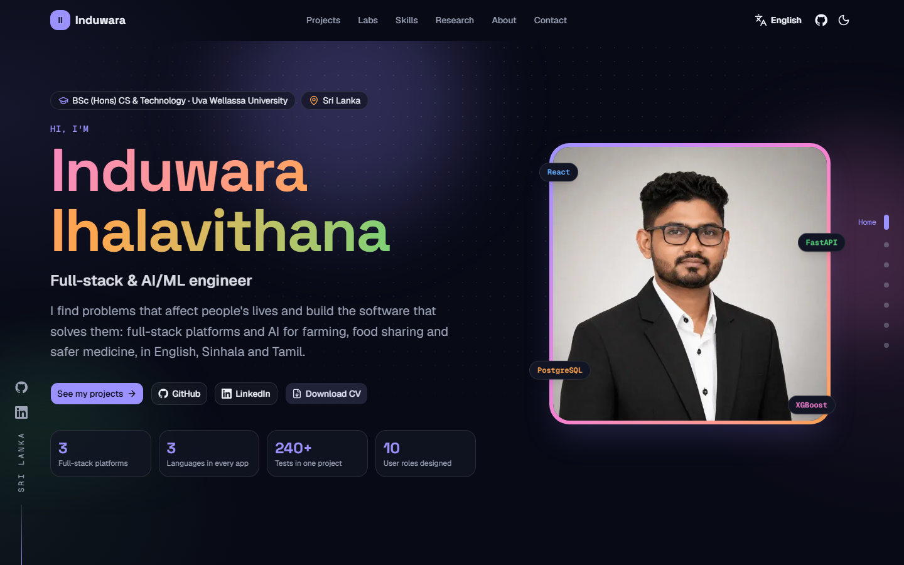

# My Portfolio

Personal portfolio of **Induwara Ihalavithana**: full-stack projects, research, case studies and a free study guide.

**Live:** https://induwara-ihalavithana.vercel.app (deployed on Vercel; every push to `main` redeploys)

[](https://induwara-ihalavithana.vercel.app)

## Study guide

A free study guide for students who want to become full-stack, AI, ML or deep learning engineers:
https://induwara-ihalavithana.vercel.app/en/guide (also in [Sinhala](https://induwara-ihalavithana.vercel.app/si/guide) and [Tamil](https://induwara-ihalavithana.vercel.app/ta/guide)).

- **30 slide decks, 291 topics** in four tracks: Foundations, Full-stack, AI / ML / DL, and Working as an engineer (principles, SDLC and requirements, teamwork, documentation)
- Each deck: a guide character, one slide per topic (meaning, analogy, real scenario, when to use it, plus a diagram, chart, table, code or comparison), a toolbox of today's tools with how to choose, a recap and an optional 4-question quiz
- Role paths (full-stack, AI, ML, DL engineer), practice projects by level and free resources
- Progress and quiz scores are saved in the browser only; no account needed
- Deep links to a slide (`/en/guide/backend#12`), arrow keys and swipe

**Stack:** Next.js 16 (App Router, Cache Components) · React 19 · TypeScript · Tailwind CSS v4 · shadcn/ui · Motion · MDX · Vitest · deployed on Vercel

## Run it locally

Needs Node.js 22.

```bash
npm install
npm run dev
```

Open http://localhost:3000. It redirects to `/en`, `/si` or `/ta` (the visitor's last choice, else their browser language).

## Scripts

| Command | What it does |
|---|---|
| `npm run dev` | Dev server with hot reload |
| `npm run build` | Production build (pages are prerendered as static HTML) |
| `npm run lint` | ESLint |
| `npm run typecheck` | Generates Next.js route types, then runs `tsc` |
| `npm test` | Vitest + Testing Library |
| `npm run cv` | Rebuilds `public/cv/Induwara-Ihalavithana-CV.pdf` from `cv/cv.html` (needs Chrome or Edge) |

CI (`.github/workflows/ci.yml`) runs lint, typecheck, tests and build on every push.

## Editing content

Wording and facts are kept apart:

| File | Holds |
|---|---|
| `src/i18n/dictionaries/en.ts` | All English text; defines the shape the other languages must match |
| `src/i18n/dictionaries/si.ts`, `ta.ts` | Sinhala and Tamil text |
| `src/data/site.ts` | Name, links, photo |
| `src/data/projects.ts` | Project facts: links, covers, stack, stat values |
| `src/data/labs.ts` | Lab facts: repo link, cover and slides (in `public/labs`), demo post link, stack |
| `src/data/research.ts` | Research facts: official title, authors, poster files |
| `src/data/guide/` | Study guide structure: decks, topics, visuals, quiz answers, tool lists |
| `src/i18n/guide/{en,si,ta}/` | Study guide wording, one folder per language (tests check every language has the same keys) |
| `src/data/skills.ts` | Skill groups |
| `cv/cv.html` | CV source (rebuild the PDF with `npm run cv`) |

Change a sentence in all three dictionaries. Tests fail if a language misses a string, has an empty one,
or has English left in a Sinhala or Tamil sentence.

## Layout

```
src/
  app/[lang]/     root layout and page, rendered once per language
  app/[lang]/guide/  study guide: deck list and the slide player (/guide/[deck])
  app/            global styles (theme tokens)
  i18n/           locales, dictionaries, getDictionary
  proxy.ts        redirects "/" to the right language
  components/     header, footer, project card, animation helpers
    sections/     hero, projects, labs, guide teaser, skills, research, about, contact
    guide/        slides, charts and diagrams, deck grid, role paths, progress store
    ui/           shadcn/ui components
  data/           site content
```
